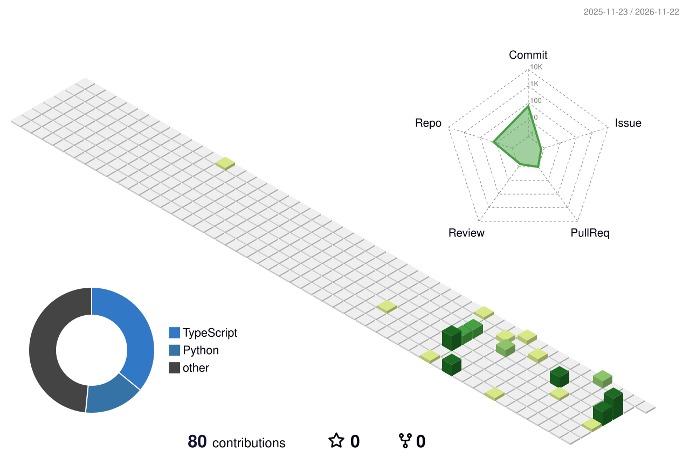

<!-- ===================================================== -->
<!--                    HEADER / BANNER                    -->
<!-- ===================================================== -->

<!-- ==================== PROFILE HEADER ==================== -->

  

   

  <strong>Integrated M.Tech Software Engineering Student</strong>
   
  VIT Vellore · Class of 2027

    

  
  
  
  

 

---
<!-- ==================== END PROFILE HEADER ==================== -->

---

## 👨‍💻 About Me

I'm an **Integrated M.Tech Software Engineering student at VIT Vellore**, graduating in 2027, focused on building reliable backend systems, full-stack applications and practical AI-powered solutions.

- 💻 Building applications with **Python, FastAPI, React and TypeScript**
- 🤖 Exploring **Applied AI/ML, Retrieval-Augmented Generation (RAG) and AI Agent Security**
- ⚙️ Interested in REST API design, database integration, system reliability and automated testing
- 🧪 Experienced with **pytest and Vitest** for testing software systems
- 🚀 Developed individual and client-focused projects across software engineering and applied AI
- 🤝 Open to Graduate Software Engineer opportunities and meaningful collaborations

---

## 🛠️ Technical Skills

**Languages**

**Backend & Databases**

**Frontend**

**AI / Machine Learning**

**Testing & Tools**

---

## 🚀 Featured Projects

### 1. AgentSentinel — Runtime Governance for AI Agents

**Individual M.Tech Dissertation · VIT Vellore**

A runtime governance system designed to inspect AI agent tool calls before execution and enforce policy-based decisions.

- Built a **12-module architecture** with pre-execution interception and fail-closed enforcement.
- Implemented action normalization, behavioral tracking and 22-feature extraction.
- Developed a Random Forest risk model with task-context authorization and policy fusion.
- Built audit persistence using FastAPI, SQLite and SQLAlchemy, alongside a React/TypeScript dashboard.
- Tests verify that blocked actions are not executed.

**Internal evaluation:** 72.40% accuracy · 78.95% precision · 60.48% recall · 68.49% F1 · 0.7782 ROC-AUC.

**Testing:** 523 documented pytest tests.

> Metrics are from an internal evaluation on 250 held-out samples drawn from 1,000 ATBench trajectories, not an independent benchmark.

**Tech:** Python · FastAPI · Random Forest · SQLite · SQLAlchemy · React · TypeScript · pytest

[View Repository](https://github.com/santhoshraghuraman/AgentSentinel)

---

### 2. SciPilot — Scientific Document Research Assistant

**AI Intern Project · AICTE–Edunet Foundation (IBM SkillsBuild)**

A research assistant that processes scientific PDFs through a seven-stage pipeline.

- Implemented PDF extraction and overlapping text chunking with PyMuPDF.
- Built FAISS retrieval with Maximum Marginal Relevance (MMR) re-ranking.
- Added citation coverage, n-gram grounding verification and confidence scoring.
- Supports APA/IEEE citations and Markdown/PDF report export.
- Created a five-tab Streamlit interface.

**Testing:** 378 documented pytest tests.

**Demo status:** Demonstrated in local demo mode. IBM watsonx.ai integration is implemented but has not been live-validated.

**Tech:** Python · Streamlit · PyMuPDF · FAISS · RAG · pytest

[View Repository](https://github.com/santhoshraghuraman/SciPilot)

---

### 3. Adaptive Layout Engine

A framework-agnostic TypeScript engine that generates optimized layouts across six advertising surfaces.

- Built a **10-module TypeScript core** without React or DOM dependencies.
- Implemented constraint validation and weighted candidate ranking.
- Used binary-search text fitting to handle layout constraints.
- Evaluated through automated Vitest tests and benchmark runs.

**Testing:** 61 documented Vitest tests.

**Benchmark:** 0.110 ms mean and 0.065 ms median computation time across 900 runs.

**Tech:** TypeScript · React · Vite · Vitest

[View Repository](https://github.com/santhoshraghuraman/flamai-adaptive-layout-engine)
[Live Demo](https://flamai-adaptive-layout-engine.vercel.app/)

---

### 4. Reliable Vision — Lead Management Platform

**Client project · Milestone 1**

A CRM-style lead management application that streamlines spreadsheet-based lead intake and record management.

- Supports Excel/CSV upload, preview and row validation.
- Detects duplicate phone numbers within uploads and against existing Supabase records.
- Imports valid leads and provides searchable records, lead details and dashboard statistics.

**Current scope:** Milestone 1 (Excel → CRM → Supabase). WhatsApp messaging, n8n workflows, Gemini scoring, webhook processing and campaign management are planned extensions, not claimed as implemented.

**Stack:** Next.js · TypeScript · Tailwind CSS · Supabase

[GitHub Repository](https://github.com/santhoshraghuraman/reliable-vision-automation)

---

### 5. Nearva — Local Service Discovery Platform

**Primary developer**

A hyperlocal platform connecting users with nearby service providers.

- Implemented worker registration and admin approval workflows.
- Built service discovery and filtering.
- Integrated map-based discovery using Leaflet.js and OpenStreetMap.

**Stack:** Python · FastAPI · Supabase · Leaflet.js · OpenStreetMap

[GitHub Repository](https://github.com/santhoshraghuraman/nearva) · [Website](https://www.nearva.in/)

---

## 💼 Experience

**AI Intern — AICTE–Edunet Foundation (IBM SkillsBuild Program)**  
*June 2026 – July 2026*

- Developed SciPilot, a scientific-document research assistant.
- Worked on PDF processing, RAG retrieval, grounding verification and report generation.

**Freelance Software Developer**  
*December 2024 – Present*

- Delivered 5+ freelance web projects across e-commerce, business and portfolio domains.
- Built and deployed a document-submission platform with an admin dashboard for Al Madina Consultants.
- Replaced manual WhatsApp document collection with a structured workflow using FastAPI, Supabase and Cloudinary.

---

## 📜 Patent Application

**Co-inventor — Fourth Listed**

*IN202641067193 A1*

**System and Method for Victim-Side Detection and Attribution of SMS and Call Bombing Attacks**

Filed on 29 May 2026 at Vellore Institute of Technology.

*Published Indian patent application — not yet granted.*

---

## 🏅 Certifications

- Oracle Cloud Infrastructure 2025 Certified AI Foundations Associate
- Supervised Machine Learning — Stanford Online & DeepLearning.AI
- Python for Data Science — IBM

---

## 📊 GitHub Statistics

  

  

   

  

---

## 🧊 3D Contribution Calendar

  

---

  **Thanks for visiting my profile!**

  Feel free to explore my repositories or connect with me.

  

